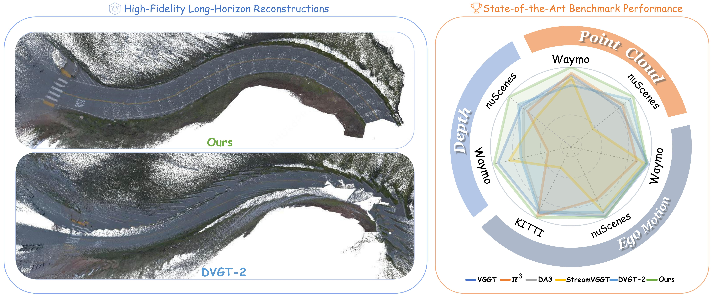
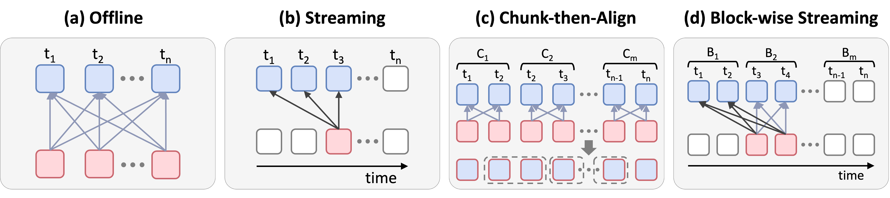
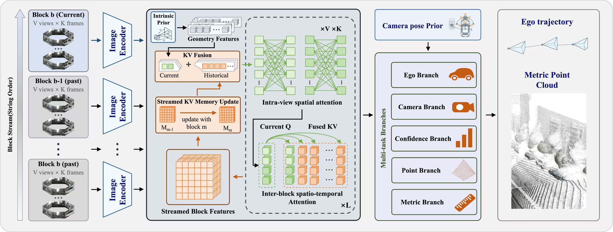

<div align="center">

<h1>Drive3R: Block-wise Streaming Geometric Foundation Models for Autonomous Driving</h1>

<p align="center">
  Tianyi Yang<sup>1,2</sup>, Haojun Yang<sup>1</sup>, Jipeng Xiao<sup>1</sup>, Xuesong Chen<sup>2</sup><br>
  Shaoshuai Shi<sup>2</sup>, Li Jiang<sup>3</sup>, Zhipeng Zhang<sup>1,*</sup>
</p>

<p align="center">
  <sup>1</sup> AutoLab, School of Artificial Intelligence, Shanghai Jiao Tong University<br>
  <sup>2</sup> Voyager Research, Didi Chuxing<br>
  <sup>3</sup> The Chinese University of Hong Kong, Shenzhen<br>
  <sup>*</sup> Corresponding author
</p>

<p align="center">
  <a href="https://silence-ai423.github.io/Drive3R/" target="_blank"></a>
  <a href="https://silence-ai423.github.io/Drive3R/assets/drive3r-paper.pdf?v=29316ee84bb6" target="_blank"></a>
  <a href="https://huggingface.co/Young857/Drive3R" target="_blank"></a>
  <a href="./LICENSE"></a>
</p>

</div>

> **Drive3R** is a **block-wise streaming** geometric foundation model
> tailored for the long-horizon, multi-camera demands of autonomous driving.
> It unifies (i) **intra-block bidirectional precision**, (ii) **cross-block
> streaming throughput** via KV-cache reuse, and (iii) **drift-aware
> long-sequence stability** via a confidence-driven re-anchoring head — all
> within a single network.

<p align="center">
<strong><big>If you find our work useful, please consider giving us a star 🌟</big></strong>
</p>



## 🔎 Overview

Autonomous driving inherently involves **continuous, long-horizon video
streams**, where a single log can easily span thousands of frames across
multiple cameras. Existing feed-forward geometric foundation models either
(a) keep full bidirectional attention and hit a hard wall on memory and
complexity, (b) run strict per-frame causal streaming and accumulate scale
drift, or (c) use *chunk-then-align* heuristics that fragment global context
and produce jarring trajectory discontinuities.

**Drive3R** resolves this conflict with two synergistic designs:

- **Block-wise causal attention.** Tokens inside each temporal block attend
  bidirectionally to establish a robust local geometric context, while
  **strict causality across blocks** plus **cross-block KV-cache reuse**
  propagates historical features for long-range consistency and scalable
  streaming inference.
- **Confidence-aware re-anchoring.** A lightweight per-block confidence head
  predicts accumulated drift online. When the confidence drops below a
  threshold, Drive3R proactively discards the stale KV cache, re-initialises
  a fresh block, and stitches the new segment into the global trajectory via
  **SE(3) alignment** on overlapping frames — yielding discontinuity-free
  recovery in dynamic environments.

### Paradigm comparison



### Pipeline



Drive3R extends a ViT-based feed-forward backbone with multi-camera ring +
temporal sampling (`T` frames × `V` cameras), per-pixel ray injection and
per-frame `cam_to_ego` injection, and dedicated heads for **dense local
geometry**, **camera pose**, **per-frame ego pose**, **metric scale**, and
**per-block ego confidence**. At inference time the same network operates in
a streaming block-wise loop driven by KV-cache reuse and confidence-aware
re-anchoring.

## 🛠️ Installation

```bash
# Python 3.10 recommended
conda create -n drive3r python=3.10 -y
conda activate drive3r

# Install PyTorch 2.5.1 / CUDA wheels first (pick the build matching your CUDA).
pip install torch==2.5.1 --index-url https://download.pytorch.org/whl/cu121

pip install -r requirements.txt
```

Drive3R provides streaming inference and optional depth densification for
scene folders and JSON manifests.

## 🤗 Checkpoints

Download the final Drive3R weights from [Hugging Face](https://huggingface.co/Young857/Drive3R):

```bash
export DRIVE3R_CKPT_ROOT=/path/to/ckpts
hf download Young857/Drive3R drive3r.pt --local-dir "$DRIVE3R_CKPT_ROOT"
```

The commands below use `--ckpt $DRIVE3R_CKPT_ROOT/drive3r.pt`.

Use the released Drive3R checkpoint with matching model options. Supported
formats are PyTorch `.pt` state dictionaries and `.safetensors`.

## ▶️ Quick start: scene folder

Arrange a synchronized multi-camera sequence using this scene layout:

```text
SCENE/
├── images/
│   ├── 000_0.jpg
│   ├── 000_1.jpg
│   ├── 001_0.jpg
│   └── 001_1.jpg
└── camera/
    ├── intrinsics/0.txt, 1.txt     # pixel-space 3x3 K, or fx fy cx cy
    └── cam2ego/0.txt, 1.txt        # camera-to-ego rigid 4x4 matrices
```

Images use `<frame>_<integer-camera-id>.<extension>`. All selected frames
must contain the same camera IDs. Cameras are sorted numerically; numeric
frame IDs are sorted numerically and other IDs lexically. Static camera
calibration files use the camera ID, while per-image calibration files can
use the full image stem, e.g. `camera/intrinsics/000_0.txt`. Matrix files
may be `.txt` or `.npy`. Camera axes are x right, y down, z forward; pose
translations are in meters. Calibrations must match the original images.

```bash
python scripts/inference.py \
    --checkpoint "$DRIVE3R_CKPT_ROOT/drive3r.pt" \
    --input_path SCENE --output_dir outputs/scene \
    --use-multimodal --enable-intrinsics-injection \
    --block-size 3
```

Frame and camera counts are discovered automatically. `--num_frames`,
`--num_views`, `--stride`, and `--start-index` optionally restrict the clip.
The ego head requires `camera/cam2ego/`; omit the ego head with
`--no-ego-pose` if those extrinsics are unavailable. Intrinsics are required
when enabling the intrinsic injection branch.

## 🚀 Other inference input layouts

`scripts/inference.py` runs a pretrained Drive3R checkpoint on a
multi-camera clip and dumps per-frame poses, an ego trajectory, and a fused
world point cloud.

Block streaming defaults to `--cross-attn-mode global`. For the `cross`
attention pattern, use `--block-size 0` for a full-clip forward. Relative
image paths in JSON manifests are resolved against the manifest's directory.
The confidence decoder retains each segment's first frame as its reference;
the first block of a segment does not trigger a confidence-based restart
while it establishes the new reference frame.

### Per-camera sub-folder layout (default)

```
SCENE/
├── CAM_FRONT/
│   ├── 000000.jpg
│   ├── 000001.jpg
│   └── ...
├── CAM_FRONT_LEFT/
│   └── ...
├── CAM_FRONT_RIGHT/
│   └── ...
├── CAM_BACK/
├── CAM_BACK_LEFT/
└── CAM_BACK_RIGHT/
```

```bash
python scripts/inference.py \
    --ckpt $DRIVE3R_CKPT_ROOT/drive3r.pt \
    --image-dir SCENE \
    --num-cameras 6 --num-frames 24 \
    --resolution 518x336 --block-size 3 \
    --use-multimodal --enable-intrinsics-injection \
    --intrinsics-json SCENE/intrinsics.json \
    --cam-to-ego-json SCENE/cam_to_ego.json \
    --output-dir outputs/scene_demo
```

### JSON manifest layout (recommended for scripted inference)

```json
{
  "num_cameras": 6,
  "num_frames":  24,
  "frames": [
    { "cameras": ["frame0/cam0.jpg", "frame0/cam1.jpg", "...", "frame0/cam5.jpg"] },
    { "cameras": ["frame1/cam0.jpg", "frame1/cam1.jpg", "...", "frame1/cam5.jpg"] }
  ],
  "intrinsics": [
    [[fx, 0, cx], [0, fy, cy], [0, 0, 1]],
    "..."
  ],
  "cam_to_ego": [
    [[1, 0, 0, tx], [0, 1, 0, ty], [0, 0, 1, tz], [0, 0, 0, 1]],
    "..."
  ]
}
```

```bash
python scripts/inference.py \
    --ckpt $DRIVE3R_CKPT_ROOT/drive3r.pt \
    --manifest scene.json --resolution 518x336 \
    --use-multimodal --enable-intrinsics-injection \
    --block-size 3 --output-dir outputs/scene
```

Outputs in `--output-dir`:

| File | Content |
| --- | --- |
| `pred.npz`              | `local_points (1,T*V,H,W,3)`, `camera_poses (1,T*V,4,4)`, `ego_poses (1,T,4,4)`, `metric` |
| `trajectory_ego.txt`    | TUM-format ego trajectory (`timestamp tx ty tz qx qy qz qw`) |
| `world_pointcloud.ply`  | fused world point cloud, optionally sub-sampled |
| `stats.json`            | block size, ego-conf logits, restart events, run config |

### Long-clip streaming with confidence-aware re-anchoring

For long sequences, let the per-block ego-confidence head decide when to
drop the KV cache and start a fresh segment (segments are stitched via
SE(3) alignment on overlapping frames):

```bash
python scripts/inference.py \
    --ckpt $DRIVE3R_CKPT_ROOT/drive3r.pt \
    --manifest scene.json --block-size 3 \
    --use-multimodal --enable-intrinsics-injection \
    --enable-restart --ego-conf-threshold 0.9 \
    --output-dir outputs/scene_long
```

By default `--enable-restart` is off and the script does pure block-wise
streaming with a persistent KV cache.

### Interactive viser visualization

Append `--viser` to launch an interactive 3D viewer (point cloud + camera
frustums + ego trajectory) on `http://<host>:8080`:

```bash
python scripts/inference.py \
    --ckpt $DRIVE3R_CKPT_ROOT/drive3r.pt \
    --manifest scene.json --output-dir outputs/scene \
    --use-multimodal --enable-intrinsics-injection \
    --viser --viser-port 8080
```

## 📂 Depth densification

`scripts/generate_dense_gt.py` predicts dense depth with MoGe-2, affine-aligns it to
sparse measurements in meters, and filters low-quality results. It runs
independently of Drive3R inference and produces **model-assisted pseudo-GT**
depth in meters.

Install the optional [MoGe-2](https://github.com/microsoft/MoGe) dependency:

```bash
pip install git+https://github.com/microsoft/MoGe.git
```

Use the scene layout above and add `sparse_depths/` with a depth map
for each image, e.g. `images/000_0.jpg` pairs with `sparse_depths/000_0.npy`.
Sparse depth must have the original image's `(H, W)` shape and contain
**camera-Z depth in meters**, with zero for invalid pixels.

```bash
python scripts/generate_dense_gt.py \
    --input_path SCENE --output_dir outputs/dense \
    --save-sparse-depth
```

For arbitrary image names or calibrated XYZ points, use a JSON manifest:

```json
{
  "samples": [
    {
      "id": "scene/front_000",
      "image": "images/front_000.jpg",
      "sparse_depth": "depth/front_000.npy"
    },
    {
      "id": "scene/front_001",
      "image": "images/front_001.jpg",
      "lidar_points": "points/front_001.npy",
      "intrinsic": [[800, 0, 640], [0, 800, 360], [0, 0, 1]],
      "lidar_to_camera": [[1, 0, 0, 0], [0, 1, 0, 0], [0, 0, 1, 0], [0, 0, 0, 1]]
    }
  ]
}
```

Each sample provides exactly one of `sparse_depth` or `lidar_points`.
Point arrays have shape `(N, 3)` and use meters; `lidar_to_camera` maps
those coordinates into OpenCV camera axes (x right, y down, z forward).
The identity example applies only when the points are already in the camera
frame. Supply your calibrated transform otherwise. Images must be
undistorted and synchronized with the points; projection keeps the nearest
point at each pixel. Intrinsics are in pixels at the original image size.

Both input arrays support `.npy` and `.npz`. Use `sparse_depth` or `points`
as the `.npz` key, respectively; a single-array archive is also accepted.
File paths are relative to the manifest. IDs are unique relative output
paths using letters, digits, `_`, `-`, `.` and `/`. If omitted, IDs use the
sample index, e.g. `000000`. Optional `intrinsic`, `cam_to_ego`, and
`ego_to_global` metadata are copied to accepted outputs.

```bash
python scripts/generate_dense_gt.py \
    --manifest samples.json --output-dir outputs/dense \
    --moge-model Ruicheng/moge-2-vitl --save-sparse-depth
```

MoGe-2 weights are downloaded on first use. `--moge-model` also accepts a
local checkpoint; `--device cpu` selects CPU execution. Existing outputs
are skipped unless `--overwrite` is supplied. When overwriting, a sample
that now fails quality filtering has its old output removed; successful
outputs replace existing files atomically.

Each accepted image produces `<id>.npz` with:

| Key | Content |
| --- | --- |
| `dense_depth` | `(H, W)` float32 camera-Z depth in meters; zero at invalid pixels |
| `valid_mask` | `(H, W)` bool predicted-valid region |
| `scale`, `shift` | affine alignment parameters |
| `abs_rel`, `delta_125` | alignment quality at sparse measurement locations |
| `image_path` | source image path |
| `intrinsic`, `cam_to_ego`, `ego_to_global` | calibration / pose metadata, when provided |
| `sparse_depth` | input or projected sparse depth, with `--save-sparse-depth` |

`summary.json` records saved, skipped and filtered samples with reasons.
Default filters are `--min-lidar-points 50`, `--min-lidar-spatial-std 5`,
`--min-valid-overlap 0.7`, `--max-abs-rel 0.3`, `--min-delta-125 0.6`,
`--max-scale 3`, `--max-shift 10`, and `--alignment-trunc 5`.
`--max-alignment-points 2048` bounds the affine solver's memory usage by
deterministically sampling larger measurement sets. Quality is still
evaluated at every valid sparse measurement.

## 🗂️ Repository layout

```text
Drive3R/
├── scripts/
│   ├── inference.py              # Drive3R streaming inference
│   └── generate_dense_gt.py      # optional depth densification
├── src/                          # model, layers, DINOv2 and input / geometry helpers
├── assets/                       # README figures
├── licenses/                     # full upstream license text snapshots
├── requirements.txt              # inference runtime
├── THIRD_PARTY_NOTICES.md
└── LICENSE
```

## ✒️ Citation

Paper: [Drive3R: Block-wise Streaming Geometric Foundation Models for Autonomous Driving](https://silence-ai423.github.io/Drive3R/assets/drive3r-paper.pdf?v=29316ee84bb6).

```bibtex
@misc{yang_drive3r,
  title = {Drive3R: Block-wise Streaming Geometric Foundation Models for Autonomous Driving},
  author = {Yang, Tianyi and Yang, Haojun and Xiao, Jipeng and Chen, Xuesong and Shi, Shaoshuai and Jiang, Li and Zhang, Zhipeng},
  note = {Research manuscript},
  url = {https://silence-ai423.github.io/Drive3R/assets/drive3r-paper.pdf}
}
```

## ❤️ Acknowledgements

Drive3R builds on [Pi3 / Pi3X](https://github.com/yyfz/Pi3),
[DINOv2](https://github.com/facebookresearch/dinov2), and
[MoGe-2](https://github.com/microsoft/MoGe). We also thank
[DUSt3R](https://github.com/naver/dust3r),
[MonST3R](https://github.com/Junyi42/monst3r),
[Spann3R](https://github.com/HengyiWang/spann3r),
[CUT3R](https://github.com/CUT3R/CUT3R), and
[StreamVGGT](https://github.com/wzzheng/StreamVGGT).

## 📄 License

Original Drive3R contributions use [CC BY-NC 4.0](./LICENSE) for
non-commercial research use. Third-party source and pretrained weights
retain their applicable licenses; see
[THIRD_PARTY_NOTICES.md](./THIRD_PARTY_NOTICES.md).
